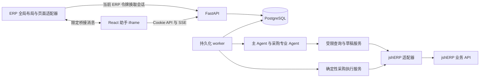

# Design

## Context

状态：首个实现增量实施中。ERP 契约与正常采购订单已在隔离环境实测，应用基础已建立；验证记录见 docs/integrations/jsh-erp-verification-v1.md 与 docs/foundation-verification.md。完整业务能力仍以 tasks.md 的已验收项目为准。业务动机与范围见 [proposal.md](proposal.md)，可观察行为见 [六项能力规范](specs/)。

源码检查对象为 Talk2Stock 提交 `e72aae4d94370d62cfc4ab7d92a2a6c5c21c8ec9` 内的 `jshERP-latest/` 快照。后端 pom 标识 `3.6-SNAPSHOT`，前端 package 标识 `3.5.0`；它们不是已验证兼容版本范围。下表路径相对于该 ERP 快照，不要求贡献者持有相同本机目录。

| 证据位置 | 已观察行为及设计影响 |
| --- | --- |
| `jshERP-web/src/components/page/GlobalLayout.vue`；`components/layouts/BasicLayout.vue`、`TabLayout.vue` | 普通和多页签布局共享全局布局；侧边栏在这里挂载，不能随路由视图反复重建 |
| `jshERP-web/src/views/material/MaterialList.vue`；`views/bill/PurchaseOrderList.vue` | 页面自行管理选中行，路由不足以表达选择；需要页面适配器 |
| `jshERP-web/src/utils/request.js`；`store/modules/user.js` | 当前 ERP 请求使用 `X-Access-Token`；宿主已持有此令牌 |
| `jshERP-boot/src/main/java/com/jsh/erp/controller/UserController.java` 的 `getUserSession`、`getUserBtnByCurrentUser`、`getCurrentPriceLimit` | 可从服务端会话、角色按钮和价格屏蔽信息构造身份及能力；不能信任浏览器用户 ID |
| `filter/LogCostFilter.java`；`service/RedisService.java` | 登录失效可能为 HTTP 500 加文本 `loginOut`；HTTP 状态不足以分类错误 |
| `controller/MaterialController.java` 的 `findBySelect` | 查询返回的 `id` 来自商品扩展 ID，不能当作基本商品 ID |
| `controller/DepotItemController.java` 的 `findStockByDepotAndBarCode` | 仓库参数可省略，条码未找到也可能得到零；必须先解析商品并显式约束仓库 |
| `controller/SupplierController.java` 的 `findBySelect_sup` | 异常路径可能返回空数组；空数组不总能证明无匹配 |
| `jshERP-web/src/views/bill/modules/PurchaseOrderModal.vue:378` | 采购订单为 `type=其它`、`subType=采购订单`，明细仓库为空，表头总金额为明细合计的负值 |
| `jshERP-web/src/views/bill/PurchaseOrderList.vue:109`；`jshERP-boot/docs/jsh_erp.sql` 的采购订单菜单 | 新增对应按钮码 `1`，路由 `/bill/purchase_order`；需与服务端返回的角色映射共同验证 |
| `service/RoleService.java` 的 `parseBillPriceByLimit` | 采购单据金额可能因价格屏蔽码 `4` 被置为不可见值；不得把屏蔽结果当作真实零金额 |
| `controller/DepotHeadController.java:613`；`entities/DepotHeadVo4Body.java` | 创建 body 使用 `info` 和 `rows` 两个 JSON 字符串，响应是通用成功，未给出新单据 ID |
| `controller/DepotHeadController.java:77/561`；`controller/DepotItemController.java:198` | 列表查询带当前用户的数据范围；按单号详情只取首条，不能证明唯一。先取得授权候选 ID，再读表头/明细核对 |
| `service/DepotHeadService.java` 的 `addDepotHeadAndDetail`、`checkExistByRedis`；`docs/jsh_erp.sql` | 创建在 ERP 事务中；短期 Redis 检查不是原子幂等协议，单号索引非唯一，助手必须自己控制并发和不确定结果 |

源码尚不能证明所有部署下的权限、精度、单位映射和库存行为。实施任务先建立契约夹具及受限用户验证，再启用相应能力；不能验证时报告 `unsupported_contract` 并关闭该能力。此设计不承诺兼容其他 jshERP 分支。

## Goals / Non-Goals

**Goals:** 让 UI、Agent 和 ERP 适配器共享清晰业务契约；将业务状态从聊天文本和框架检查点中独立出来；在不修改 ERP 数据库结构的前提下处理重复提交和未知结果；通过三个可验收阶段交付同一个采购闭环。

**Non-Goals:** 首版不拆微服务，不建通用插件/Agent 市场，不开放模型自定义代码或通用 HTTP 工具，不将所有领域都拆成 Agent，不在本次设计中确定项目许可证。业务非目标与采购支持范围沿用 proposal。

## Decisions

### 1. 模块化单体与同源 iframe 接入

采用 FastAPI 模块化单体，API 与可独立重启的后台 worker 使用同一套代码和 PostgreSQL；React/TypeScript/Vite 应用部署在 `/assistant/`。UI 使用 shadcn/ui、Tailwind、TanStack Query/Router/Table，按实际界面引入，避免只为技术清单添加依赖。后端用 Pydantic/SQLModel、Alembic 和异步 HTTP 客户端；参考 FastAPI 模板的组织方式，不复制整套模板或引入无关用户管理。

反向代理保持 ERP `/jshERP-boot`，新增 `/assistant/` 静态资源与 `/assistant/api/v1/`。React 通过 iframe 与 Vue 2/Ant Design Vue 的样式和构建隔离；iframe 同源不是安全隔离边界，安全仍依赖可信前端、服务端校验和有限桥接。宿主 CSP/助手 `frame-ancestors` 限制同源嵌入。

`integrations/jsh-erp/` 保存可审阅、可移除的宿主组件、页面适配器、补丁及安装说明。按独立运行要求，`third_party/jshERP/` 内置提交 `38ad91e197185847d14c33e86219557480f00db4` 的后端与 Vue 工程必要源码及 Apache-2.0 许可；记录来源、文件指纹和本地修改。原 SQL 只保留建表与公开菜单，不复制上游账号、密码和业务数据。该提交与既有历史契约存在源码差异，新增契约标识并重新记录身份/查询兼容验证，不以历史验证替代新版本执行验收。相比把 React 打入 Vue 包，iframe 降低构建依赖耦合；相比独立聊天站点，它保留业务页面和登录上下文；首版承担同源代理与宿主小补丁的部署成本。

入口置于 GlobalLayout，收起时不卸载会话状态；提供可调整宽度、展开详情、键盘关闭与焦点回退。小屏使用覆盖式面板。卡片注册为 `entity_choice`、`stock_result`、`purchase_draft`、`task_status`、`execution_result`，仅渲染声明过的结构，不渲染模型 HTML 或脚本。

侧边栏采用对话优先布局（2026-11-13）：宿主只提供品牌、调整宽度、展开与关闭；iframe 顶部提供会话标题、历史会话和新建入口，中部单一消息滚动区，底部固定输入框。正常身份摘要收为轻量文字，只在连接/模型异常时显示状态提示；接口文档与开发验证不出现在日常对话主界面。窄屏同样保持输入可见。历史会话面板支持按标题搜索和切换，默认标题以首条用户输入概括并提供创建时间，不调用模型命名，不新增删除/重命名接口。新建空会话不发业务请求，首条消息才创建会话。

同一会话的消息按时间统一展示，任务标签仅明确后续消息的作用范围；切换任务仍使用原 task_id 和服务端隔离的模型历史，不混用业务上下文。普通会话可随时恢复。采购任务使用中性名称，不把可能已经过时的初始页面选择当作当前草稿商品。已完成或冻结的采购卡片先展示商品、金额和执行状态，明细按需展开；可编辑草稿与确认面板仍展示完整内容。会话选择不得默认跳到其他会话的首个任务。页面上下文只显示一行摘要，保存/采用选择和本人任务放入按需面板。采购草稿在最新引用处展示一份可操作卡片，旧引用提供定位入口；仅当任务草稿没有消息引用时在消息区补充展示，避免另设常驻任务面板重复卡片。新建/切换会话不触发确认、写入或取消原作业。会话标题与时间通过现有列表 API 的向后兼容字段返回；标题只取本人用户输入或已有自定义标题，不采用 ERP 回复中的受限内容。

交互依据：SAP Joule Web Client 的会话导航、新建与富卡片（`https://help.sap.com/docs/JOULE/3fdd7b321eb24d1b9d40605dce822e84/78eaaa329efe409088028eab5118fec9.html`）；Microsoft Copilot help pane 的对话与交互卡片（`https://learn.microsoft.com/en-us/dynamics365/contact-center/administer/copilot-enable-help-pane`）；Salesforce Setup with Agentforce 的侧面板及展开卡片（`https://help.salesforce.com/s/articleView?id=xcloud.setup_agentforce_use.htm&language=en_US&type=5`）。只参考渐进展示方式，不宣称具有这些产品的其他能力。

本地默认 Compose 在本仓库构建 ERP 后端、带宿主补丁的 ERP Web、React 静态页面及 FastAPI/worker，并启动独立 PostgreSQL/MySQL/Redis。代理通过 Compose 服务名转发，无宿主目录和其他项目服务依赖。模型连接仍需用户提供。初始化使用本仓库生成的虚构账号与随机凭据，拒绝覆盖已有配置或数据；迁移作为独立一次性服务完成后才启动 API/worker。停止或重建容器保留数据卷，禁止自动重置已有 ERP 数据。开发热更新作为可选覆盖，不影响默认独立栈。

### 2. 复用 ERP 会话并在后端收敛权限

1. 宿主读取现有 ERP 令牌，以 `X-Access-Token` 调用 `POST /session/exchange`。连接由服务端部署配置解析，不能让浏览器传入任意 ERP 地址。
2. 后端通过 `/user/getUserSession` 确认真实 `(connection_id, tenant_id, erp_user_id)`，获取当前菜单/按钮、价格屏蔽与授权仓库。租户不从令牌后缀或浏览器对象推断。
3. 建立随机助手会话，设置生产环境 `Secure; HttpOnly; SameSite=Lax; Path=/assistant/` Cookie。ERP 令牌加密保存在服务端 session 记录，模型密钥由服务端配置读取；均不进入 URL、事件、日志、Agent 状态或检查点。
4. iframe 通过 `/session` 获取验证过的身份摘要、会话代次与 CSRF 令牌。变更请求验证 Origin、CSRF 和预期会话代次。SSE 只带非敏感游标与代次，不把访问令牌放进查询参数。
5. 每次 ERP 事实查询前验证相关权限；确认与实际发送前重新取得权限和登录状态。对无权限、权限接口失败和结构不识别分别映射错误，均不能扩大能力。普通交流可不调用 ERP，失去登录时不再开放业务数据接口。
6. 宿主登出/切换账号撤销对应助手 session，并广播使其他标签页清理缓存和关闭事件流。重新交换时旋转会话代次；旧代次请求返回 `session_changed`，前端只渲染匹配代次的响应，避免 Cookie 在多标签页切换后展示串号。

首次实现不使用共享后台账号、双套密码系统或只信任前端菜单的接入。权限适配器将服务端角色事实映射为 `material.read`、`supplier.read`、`stock.read(depot_ids)`、`purchase.read`、`purchase.create` 和价格字段范围。已观察到采购新增为路由 `/bill/purchase_order` 的按钮码 `1`，采购单据价格屏蔽含 `4`；完整映射必须通过有/无该权限的普通用户契约测试。管理员接口可能省略 `userBtn`，不能将任意缺失字段解释为管理员；只支持明确验证的服务端管理员分支，否则关闭写入。

采购首版要求具备所需价格查看能力，防止用户在无法查看完整金额时确认。仓库查询始终发送授权仓库 ID，不能因为订单不需要仓库就放开库存查询。记录读取同样检查业务范围，不能只校验新建按钮。过去查询结果带权限来源标签；权限指纹变化时隔离不再可读的历史消息、摘要和卡片，清除相关模型记忆并从仍可读的数据重建上下文，服务端不再向模型和界面发送旧价格。

ERP token 有效性由 ERP 决定，助手不延长 ERP 权限；绝对过期上限、空闲回收可配置。身份失效会阻断新写入，已发出的未知执行保留原所有者；等待其重新登录后继续授权回查，不能借用新账号核对。

### 3. 版本化宿主桥接和上下文快照

协议 `version=1`，消息包含 `request_id`、每次加载的 bridge nonce 和类型。收发均验证 `event.origin === configured_origin`、`event.source` 为已知父窗口/iframe、版本、大小及 schema；使用精确 `targetOrigin`。nonce 用于关联，不当作登录凭据。

| 方向 | 消息类型 | 允许内容 |
| --- | --- | --- |
| iframe → 宿主 | `assistant.ready` | 请求当前上下文及会话就绪状态 |
| 宿主 → iframe | `context.set` | 页面类型、上下文 revision、选中记录类型与 ID、可选授权仓库提示、采集时间 |
| 宿主 → iframe | `auth.changed` | 请求清空显示并重新取得助手会话，不传原始令牌 |
| iframe → 宿主 | `host.open_record` | 服务端已核实的采购订单 ID/单号，宿主按白名单构造路由 |
| iframe → 宿主 | `host.refresh_records` | 请求刷新采购订单列表，不传任意路径或代码 |

商品列表和采购订单列表适配器分别监听路由、页签、选择变化与卸载，离开后清除旧选择；其他页面发送 `context_unavailable`。页面只传 ID 和必要摘要，后端重新读取并授权，不采集整页 DOM 或隐藏表格数据。

消息提交保存当时的 `page_context_snapshot`；任务保存自己的 `task_context`；草稿独立保存业务字段。选中多条订单只为查询和引用提供上下文，不表示批量审核或修改。商品跨页选择、旧页签缓存与过期上下文均有 revision 检查，用户明确采用新选择才更新任务及草稿。

### 4. 动态对话编排与确定性执行分开

采用 LangGraph 承载有界对话运行及采购委派，采用 PostgreSQL checkpointer 支持恢复；框架检查点只保存推理所需的脱敏状态，业务资源以领域表为准。持久化执行意味着恢复可能重进节点，因此业务修改有独立命令标识，ERP 写入不在可重放的模型/工具节点中执行。

选择理由：此场景有澄清、暂停、继续和故障恢复，显式图及检查点有助于维护。纯手写循环需要自建这些机制；仅因微软模式就绑定 Azure 或某个 Agent SDK 没有必要。本项目采用微软的主/专业职责及流程模式，框架是实现选择，不意味着微软官方推荐本项目技术栈。框架封装在 `orchestration/`，领域服务不依赖图节点。

主 Agent 可普通交流、调用只读工具、提出结构化草稿修改命令或委派采购专业 Agent。专业 Agent 负责商品/单位歧义、多明细准备及缺项整理，不拥有写 ERP 工具；简单库存查询不再建立库存 Agent。两者的草稿命令都经同一领域服务校验。

委派输入：`task_id`、目标、用户消息、已授权必要上下文、`expected_draft_version`、允许工具及共享预算标识。principal 由 worker 的可信运行上下文绑定，不能由模型改写。输出：`status` 为 `completed|needs_input|partial|failed`，以及 `facts`、`source_refs`、`proposed_patch`、`missing_fields`、`warnings`、`error`；来源带查询时间。输出先校验结构及归属，再进入主 Agent 汇总。

初始可配置预算：一轮总模型调用 6 次、工具调用 12 次、专业委派深度 1、委派次数 2、总时长 90 秒；主/子 Agent 共享预算而非分别翻倍。模型失败最多额外重试 1 次，也占预算；查询最多重试 2 次并遵守全局时限；首版默认不自动重试 ERP 查询。模型/工具调用在独立 guard 节点先持久化预算预留，恢复到外部调用节点时重新预留，保证中断不会获得免费调用；同参数重复查询不再访问 ERP。达到预算返回部分结果和继续入口，后续显式继续建立新运行。预算是保护配置，性能目标待测量。确定性写入/核对另计预算，不能因模型预算耗尽停在无记录的发送状态。

工具采用进程内类型契约和统一 ERP adapter，首版不引入 MCP 服务；需要跨应用复用时再将已稳定工具暴露为 MCP。用户描述和 ERP 自由文本属于数据，不参与工具授权；无通用 SQL、Python、任意 URL 请求或 shell 工具。

模型响应先校验外层结构、截断标记、非空文本、JSON 和决策白名单。格式失败复用同一有限重试路径，在下一次模型调用中加入固定格式提醒，不将无效原文加入历史；重试先经过身份及预算 guard，再持久化预留调用次数。失败 trace 的 `reason` 仅使用固定枚举：`invalid_envelope`、`empty_content`、`truncated_output`、`invalid_json`、`invalid_decision`、`response_too_large`，不保存校验输入或原文。重试仍失败时按错误类型说明原因，无事实时不声称保留查询结果，也不要求用户补充信息来掩盖模型故障。该修正不改变 API 或数据库结构，已有历史失败消息保留原记录。

采购草稿准备接受 `material.unit` 以及同一扩展条码当前已核实的 `material.unit_label` 的精确匹配。展示标签只是别名：服务端取得商品详情后映射为其规范单位，再检查该单位的配置换算；不通过切割括号、模型推断或替换条码完成转换。保留原始草稿输入用于命令去重及编辑重放，计算和确认快照始终使用规范单位。主 Agent 提示明确展示标签与提交单位的区别；不改变 ERP 写入开关和确认规则。该修正无数据库迁移。

### 5. 持久化模型、串行处理及事件

使用一个 PostgreSQL 承担助手领域状态、检查点、持久化工作队列及事件，避免首版同时运维 Redis/Celery。ERP 自己的数据库和 Redis 继续由 ERP 部署管理。worker 使用数据库租约领取有限批任务；数据库运行中短暂不可用时，按 1–30 秒有上限退避继续领取，恢复后仍按持久化租约和发送标记处理，不打印驱动异常；持久化业务变更与待发布事件在同一事务提交，事件流读取 outbox，不能先显示业务成功再保存状态。

| 记录 | 主要字段与约束 |
| --- | --- |
| `erp_connection` / `assistant_session` | 受控 ERP 地址、契约版本；session 的 principal、加密令牌、过期时间、代次 |
| `conversation` / `message` / `run` | 所有者、消息及上下文快照、权限来源标签、运行预算和状态；同一会话一个活跃推理运行 |
| `task` | 独立任务上下文、业务类型、状态、当前草稿、恢复/阻断原因 |
| `purchase_draft` / `draft_revision` | 最新版本及不可变历史，供应商、日期、明细、备注、金额、校验结果 |
| `confirmation` | principal、草稿版本、规范化完整内容 hash、随机挑战 hash、有效期、使用时间 |
| `execution` | 不可变确认快照、原所有者、ERP 单号、一次发送标记、状态、回查次数、已核实回执 |
| `job` / `execution_job` | 分别关联对话运行和采购执行，各自具有可恢复的有限租约；执行核对不依赖模型可用性 |
| `event` / `audit` | 事件顺序/类型、脱敏审计与用量 |

所有资源都携带 owner scope `(connection_id, tenant_id, erp_user_id)`，查询在 repository 层显式限定；外部 ID 使用随机标识，但不能以难猜代替授权。unique 约束至少覆盖 `(owner, conversation_id, client_message_id)`、execution 的 `(draft_id, version)` 及 `(connection_id, tenant_id, erp_number)` 的助手执行占用。确认挑战可以到期后重新签发，但同一版本只有当前挑战有效，不能因此产生第二个 execution。有效活跃执行与未知执行都不释放去重身份。

任务消息和模型历史按明确 task_id 隔离；普通对话使用空 task_id，允许查看脱敏任务标题后询问用户选择，不自动把另一任务的事实作为当前任务输入。相同消息标识返回首次保存的上下文，不重新解析已过期页面。

同会话另一条消息在运行中返回明确 `conversation_busy`；客户端保留输入等待发送，不用无提示并发覆盖。表单 PATCH 及 Agent 修改都带 `expected_version`，冲突返回 409 和最新资源版本；Agent 不能自行覆盖用户较新的修改。只读查询可并行但共用授权及预算。

消息/卡片状态事件持久化，按会话单调递增序号续接，含 `event_id`、`task_id`、`run_id`、schema version 及资源版本。短暂 token 文本可不逐 token 入库；完成文本保存后发持久化消息事件，中断时重取已保存快照。`Last-Event-ID` 重放不触发命令；游标过期返回 `resync_required`。未知事件类型不执行动作，提示升级或重新同步。

保留期通过配置定义，会话及检查点默认 30 天、事件 7 天、普通审计 180 天；执行、确认、草稿 revision 和单号占用当前不自动清理，须另行确定业务证据保留策略；这些是运维默认值，不宣称适合所有企业。活跃/未知执行及其必要快照不得被普通清理任务删除；清理加密 session 后核对等待原用户重新登录。历史页面会提示已过期数据不可恢复。

### 6. 对外 API 与类型化卡片

统一前缀 `/assistant/api/v1`，由 OpenAPI 生成前端类型。除交换外使用助手 Cookie；变更接口验证 CSRF，全部资源接口校验 principal 与预期会话代次。错误结构为 `code/message/retryable/next_action/correlation_id`，对可修复表单错误附字段信息，不回传 ERP 原始响应中的凭据。

| API | 核心契约 |
| --- | --- |
| `POST /session/exchange`；`GET /session`；`DELETE /session` | 验证 ERP 身份、获取当前会话/能力、撤销助手会话；exchange 不允许任意 ERP URL |
| `POST /conversations`；`GET /conversations`；`GET /conversations/{id}` | 本人会话创建、列表和包含最新资源/事件游标的快照 |
| `POST /conversations/{id}/messages` | `client_message_id`、文本、可选 `task_id`、页面上下文版本及快照；返回 202 与消息/运行标识，重复返回原运行 |
| `GET /conversations/{id}/events` | SSE，支持 `Last-Event-ID`；不在流里提交命令 |
| `GET /tasks`；`GET /tasks/{id}` | 本人任务列表与详情，包含阻断原因及可用动作 |
| `POST /tasks/{id}/cancel` | 原子检查发送边界，未发送可取消；已发送返回不可保证撤回并继续核对 |
| `GET /drafts/{id}`；`PATCH /drafts/{id}` | 获取当前草稿、通过白名单业务字段和 `expected_version` 编辑 |
| `POST /drafts/{id}/confirmation` | 校验可提交性，返回完整可读快照、版本、内容 hash 及短期挑战；不发送 ERP |
| `POST /drafts/{id}/confirm` | 用户点击动作携带挑战、版本及客户端请求标识；原子冻结快照并创建或返回唯一 execution，返回 202 |
| `POST /drafts/{id}/reopen` | 仅确定未执行的失败允许修复为新版本，撤销旧确认；未知或成功执行拒绝 |
| `GET /executions/{id}`；`POST /executions/{id}/reconcile` | 查询真实状态；经授权手动触发有限回查，绝不作为再次创建接口 |

确认挑战绑定用户与内容，默认 5 分钟，持久化只存 hash；前端只在当前确认视图内短暂持有，模型不能读取。重复 confirm 即使挑战已消费，也在匹配同一所有者/草稿版本时返回原执行；没有匹配执行才报告挑战无效。业务确认与 ERP 审核是不同操作，按钮文案为“确认创建未审核采购订单”。

卡片只带资源引用、版本、显示数据及服务端计算的可用动作。历史卡片读取当前资源后决定过期/已执行状态。金额及数量通过十进制字符串传输，前端合计仅辅助展示，服务端值为准。

阶段一提供显式页面任务 API：`POST /conversations/{id}/context-tasks`（`command_id/context`）与 `POST /tasks/{id}/context`（增加 `expected_version`）。这些命令保存经过服务端重新核实的记录快照，只产生 `kind=context` 的待补充任务，不调用模型、不创建采购草稿。页面实时选择与任务快照分别展示，只有点击“采用当前选择”才变更任务。后续采购任务的更新通过草稿版本服务执行，不能走此接口绕过确认。`GET /host/purchase-orders/{id}?number=...` 只返回经过授权列表及详情 ID 核实的有限订单定位结果。

### 7. 采购领域与 ERP 契约

领域草稿保留正数量、非负单价、正向金额语义，零价格首版关闭，单价须大于零，后续另行核实契约再开放；不得把不可见价格转换成零。币种 CNY，首版强制无订金、零税、无折扣/费用；价格、单位或日期不确定时禁止进入确认。

明细保留 `material_id`、`material_extend_id`、条码、规格、`unit`、ERP 配置换算、`quantity`、`unit_price`、行金额；用户用箱等单位时查 ERP 配置而非语言模型常识。数量和单价精度、舍入方式使用部署契约参数并在卡片说明，真实 ERP 验证后固定为该 adapter 版本；不能自行凭空增加精度。日期以部署 ERP 时区解析并显示，不使用开发者本机时区作隐式默认。

| ERP 相对 API | 首版用途与限制 |
| --- | --- |
| `GET /user/getUserSession` | 验证真实用户与租户 |
| `GET /user/getUserBtnByCurrentUser`；`GET /user/getCurrentPriceLimit` | 服务端权限映射，未知结构关闭能力 |
| `GET /depot/findDepotByCurrentUser` | 授权仓库集合，不以仓库全集代替 |
| `GET /material/findBySelect` | `q/page/rows` 等查询参数；区分扩展 ID 与商品 ID，过滤价格权限 |
| `POST /supplier/findBySelect_sup` | 选择已有供应商，空结果保留不确定性 |
| `GET /depotItem/findStockByDepotAndBarCode` | 必须有已解析条码与明确授权 depotId，库存带单位与时间 |
| `GET /sequence/buildNumber` | 取 `data.defaultNumber`，按该快照前端约定加 `CGDD`；号码生成失败不启动写入 |
| `POST /depotHead/addDepotHeadAndDetail` | 固定 `info`、`rows` JSON 字符串，不允许动态选择写接口 |
| `GET /depotHead/list` | 以采购订单类型和原单号查询授权候选，分页后精确匹配号码；不可完整获取时不判定唯一 |
| `GET /depotHead/getDetailByNumber` | 仅在返回 ID 属于已授权且唯一候选时使用；首条响应不能证明唯一，空对象不能证明未提交 |
| `GET /depotItem/getDetailList` | 使用已授权 headerId 核对明细；剔除页脚合计行，识别价格屏蔽 |

写映射固定 `type=其它`、`subType=采购订单`、`status=0`，每行 `depotId` 为空。`organId` 为已验证供应商，`number` 使用持久化号码，表头 `totalPrice` 按观察到的 ERP 约定取负值，明细金额保持 ERP 前端约定；`changeAmount=0`，不发送支付账户、入库、审核或扩展业务字段。单号、主/扩展 ID、`operNumber/basicNumber`、单位及其他必需明细字段必须通过契约夹具核对，不能把自由文本直接透传为 ERP body。

回查先用带数据权限的列表取得候选，按完整单号精确过滤并确认当前用户可读，不能将按单号详情接口取到的首条直接视为授权或唯一事实。候选超过一条、分页截断或详情 ID 与授权候选不一致均转人工核对，不将该详情送入模型。这里的唯一性限于当前身份可见范围，不声称能证明全 ERP 不存在不可见重号。

ERP 只提供通用创建回执，因此完成条件为：当前身份可读取且唯一匹配的 ERP 订单，单号、创建者、类型、未审核状态、供应商、日期、备注、明细、数量/单位、金额与执行快照相符。适配器规范化符号和精度后比较。创建后发生他人审核/编辑、重号多条或价格不可读时转人工核对，不覆盖 ERP 数据或假装原状态仍存在。

### 8. 确认、发送与不确定结果状态机

任务状态概览：`ready → running → waiting_input / waiting_confirmation → executing → reconciling → completed / needs_attention`。发送前可进入 `cancelled` 或 `failed`；`auth_required` 保存恢复位置，不覆盖执行事实。`needs_attention` 表示需人工处理，不能显示成可安全重试的普通失败。

金额采用 ROUND_HALF_UP 两位小数逐行合计，数量/单价最多六位，基本数量换算超出六位时拒绝。订单日期显式提供，ERP 时区由 IANA 配置决定。

草稿状态独立为 `editing|ready|frozen|cancelled|completed`；执行状态如下：

| 状态 | 可做动作与迁移 |
| --- | --- |
| `queued` | 快照已冻结，尚未发送；重新授权/字段校验，取消可原子阻止发送 |
| `dispatching` | 已持久化发送边界标记；只允许一个 worker 进行一次 HTTP 创建 |
| `reconciling` | 发送后不论通用成功或不确定响应，都用原单号有限核对 |
| `succeeded` | 单据及明细已匹配，保存真实回执，禁止重发 |
| `rejected` | 有可信证据说明未执行或明确业务拒绝，记录可修复原因 |
| `needs_attention` | 结果未知、内容不匹配、重复单号或核对耗尽，保留去重身份和人工指引 |
| `auth_required` | 已发送后会话或读取权限失效，原账号重新登录后仅恢复原单号回查 |
| `cancelled_before_send` | 原子取消发生在发送边界前，无创建尝试 |

执行步骤：

1. `confirm` 在数据库事务内验证版本/挑战，冻结完整快照、消费挑战、保存 execution 与 job。唯一约束将重复确认汇合到原执行。
2. worker 领取任务，以原所有者验证 ERP 会话、权限、主数据及金额规则。任何变化都不静默修改已确认快照；需要变化则阻止发送并回到新版本准备。
3. 获取并持久化单号。号码生成请求丢失至多浪费号码，不是业务订单创建；发送前必须已有明确单号。确认快照不依赖用户预知单号，号码作为执行元数据追加。
4. 原子将 `queued` 改为 `dispatching`，保存一次发送标记后进行 HTTP POST。取消和发送在同一状态比较更新处互斥。代理、HTTP 客户端和任务框架禁用此 POST 的自动重试。
5. 得到响应后转 `reconciling`。只有经契约验证能证明无副作用的明确拒绝可转 `rejected`；HTTP 500、断线和无效结构一律不能直接判定为未创建。
6. 有限回查同号表头及明细。初始计划为 2、5、15、30、60 秒后各一次，时间与次数可配置，总数有限；无结果或不匹配不重新发 POST。超限转 `needs_attention`，可在原用户重新授权后手动触发新一轮只读核对。
7. 崩溃恢复：`queued` 可继续准备；遗留 `dispatching` 视为可能已发送，直接核对。租约过期只能重领核对工作，不能重领创建尝试。即使实际崩溃发生在持久化发送标记与网络发送之间，也保守转人工检查。
8. 对确定未执行的失败，用户可 reopen 生成新草稿版本、重新校验并再次确认；同一版本始终最多一次创建尝试。成功或未知执行不能 reopen，也不能通过复制当前失败任务绕过去重；用户确需另买时创建独立采购意图并明确展示旧订单结果仍待核对的风险。

表单可明确逐项取消已声明的不支持要求并保存；Agent 的草稿修改命令不能删除这些要求。主 Agent 在已取消或完成任务上再次采购须显式使用 `new_task=true` 并以版本 0 建立新任务，不复用旧草稿。

这种方案优先避免自动重复，但无法在缺少 ERP 原子幂等键的条件下保证跨系统 exactly-once，也无法原子阻止权限在最后验证与 ERP 接收之间变化。网络边界不能用助手数据库事务包住。若未来必须支持对未知结果自动重试，应单独变更 ERP 接口以提供事务内唯一幂等键，不在本次悄然扩展。

### 9. 可观测性、评估与依赖管理

所有运行关联 `conversation_id/task_id/run_id/draft_version/execution_id` 和 trace ID，默认记录状态、错误分类、响应时长、模型/工具调用次数、供应商返回 token 用量。实际费用缺失时保留空值；配置估算必须标注模型价目与估算属性，不与实际账单混淆。业务审计只存必要摘要和 ERP 标识，模型思维过程不作为产品日志或用户界面输出。

单元/契约测试覆盖金额与单位、权限映射、隔离、版本/确认和执行状态机；浏览器验证覆盖真实嵌入、上下文切换、卡片及重连。故障注入分别模拟提交前失败、提交后响应丢失、worker 崩溃、回查不可用和重复确认；替身结果与真实 ERP 结果分开报告。

真实集成只在可重置的 ERP 验证环境进行，建立普通有权用户、受限用户及第二租户，使用虚构数据，记录快照版本和配置。验证前后库存、采购订单状态/明细及无付款/审核行为；不能只读助手结果卡片判定成功。场景集含“采购可乐 → 规格澄清 → 库存查询 → 草稿 → 表单/语言修改 → 确认 → 真单核对 → 刷新恢复”，另有闲聊、越权、旧卡片、重号与故障场景。

新增依赖和配置在实施时锁定兼容版本，生成 Python/前端锁文件与来源/许可清单；不以浮动 latest 作为支持说明。`.env.example` 使用占位值，包含数据库、ERP 受控连接、同源地址、加密密钥、模型连接、预算/超时和保留期。开发可使用标明替身的测试配置，但生产不得通过开关跳过身份/权限验证。

官方模式参考来自项目架构原则；本设计的数据库、框架与预算取舍属于项目决策。资料查阅日期为 2026-11-12：

- Microsoft 主编排/专业 Agent 模式：`https://learn.microsoft.com/en-us/agents/architecture/multi-agent-orchestrator-sub-agent`
- Microsoft 面向工作流的模式：`https://learn.microsoft.com/en-us/agents/architecture/multi-agent-workflow-oriented`
- Azure 编排模式：`https://learn.microsoft.com/en-us/azure/architecture/ai-ml/guide/ai-agent-design-patterns`
- LangGraph 恢复语义及副作用约束：`https://docs.langchain.com/oss/python/langgraph/durable-execution`

## Risks / Trade-offs

- [ERP 权限接口及受限角色行为随分支变化] → 版本化权限映射、真实受限账号验证与按能力关闭，未知结构不放行。
- [ERP 号码检查非原子且无唯一索引] → 助手持久化执行及一次发送、同号内容核对；重号人工处理，不承诺全系统号码唯一。
- [保守发送边界可能让实际未发送的请求进入人工核对] → 保留标记及诊断证据，优先避免重复；不提供一键强制重发未知执行。
- [权限变更与 ERP 提交不能形成跨系统事务] → 发送前即时校验、沿用真实用户且验证 ERP 自身鉴权；记录残余边界，必要时另行加强 ERP 服务端。
- [同源前端一旦被攻陷可能影响 ERP] → iframe 仅隔离工程，可信静态资源、有限桥接、结构化卡片和服务端授权共同约束，不宣称 sandbox 安全隔离。
- [历史消息及检查点可能带已撤销的数据权限] → 按来源标签隔离历史并重建允许上下文；无法细分的历史整条隐藏，避免摘要继续泄漏。
- [旧 ERP 单号回查受价格屏蔽或他人后续修改影响] → 不可完整验证时不报告成功，转人工核对；首版写入仅对所需权限齐全用户开放。
- [首版同时引入持久化 worker 与图框架增加维护成本] → 保持单体、单数据库和单专业 Agent，以三个阶段验证；业务服务与框架隔离。
- [第一增量仍涉及多个模块] → 里程碑分别验收，默认写入关闭，前阶段可独立体验；整体闭环完成前不归档或宣称采购能力已交付。

## Migration Plan

1. 初次发布无既有应用数据迁移；先建立 Alembic 初始迁移、配置校验、数据库备份与恢复说明。
2. 第一阶段部署数据库、API/worker、前端与反向代理，使用已验证 ERP 身份，接入全局侧边栏和两个页面适配器；写入保持禁用。
3. 第二阶段启用主/采购 Agent、真实只读能力及持久化事件，完成受限用户与上下文隔离验证。
4. 第三阶段完成草稿、确认、一次发送和核对，在隔离 ERP 完成真实及故障验收后，按部署配置向支持的用户启用采购创建。
5. 回滚先关闭新写入和新任务接收，保留数据库及待核对执行，完成原身份授权下的核对/人工交接，再撤下入口。移除侧边栏不撤销已有 ERP 订单；禁止靠清空助手表解决未知状态。数据库迁移不兼容时按备份/迁移方案恢复，不能丢弃执行记录强制降级。
6. 文档记录实际验证过的 ERP 快照、宿主补丁、升级/移除方法、首次启动及各里程碑功能状态；保留复用代码的来源和现有许可声明，项目整体许可证仍由维护者决定。

## Open Questions

- 视觉细节（默认宽度、卡片密度、移动布局）在第一阶段结合真实 ERP 页面验证后调整，不影响协议和行为规范。
- 调用预算、事件/历史保留期及性能服务目标，在场景基线和部署容量测量后调整；本设计数值均为起始配置。

权限映射、价格屏蔽、采购明细精度和真实库存影响不是可延后的开放问题：它们已作为相关能力启用前的契约验收任务安排，失败时关闭对应能力，不改变安全边界或擅自替换支持范围。
